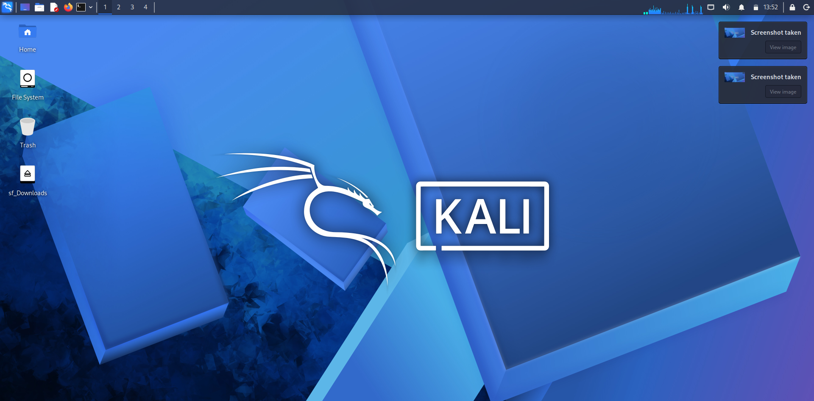

# Cybersecurity Lab Setup: VirtualBox + Kali Linux

A home lab built for cybersecurity and ethical hacking practice, using Oracle VirtualBox and Kali Linux.

## Lab Specifications

| Item | Value |
|------|-------|
| Hypervisor | Oracle VirtualBox (latest version) |
| Guest OS | Kali Linux (latest version, as a VM) |
| Network | NAT Network, 10.0.0.0/24 |
| Kali IP Address | 10.0.0.2/24 |
| Gateway | 10.0.0.1 |
| DNS | 8.8.8.8 |
| Internet Access | Yes |

## What I Did

1. Installed Oracle VirtualBox on my laptop
2. Created a NAT Network with the 10.0.0.0/24 subnet
3. Downloaded and imported the Kali Linux virtual machine
4. Enabled shared clipboard and drag-and-drop in the VM settings
5. Enabled a shared folder (host Downloads folder) between Windows and Kali
6. Configured a static IP address of 10.0.0.2/24 on Kali Linux
7. Verified that Kali has full internet access
8. Took a snapshot of the VM as a clean backup

## Screenshot

## What I Learned

- How virtual networking works in VirtualBox (NAT Network)
- How to configure a static IP address on Linux
- How shared folders and clipboard integration work between host and guest
- How snapshots help protect a lab environment before testing

## Next Steps

Hands-on practice with tools like Nmap and Wireshark.

## Disclaimer

This lab is for educational purposes only. All testing is done in my own isolated environment.
